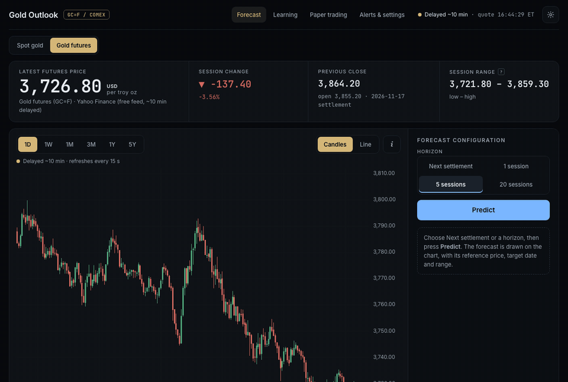
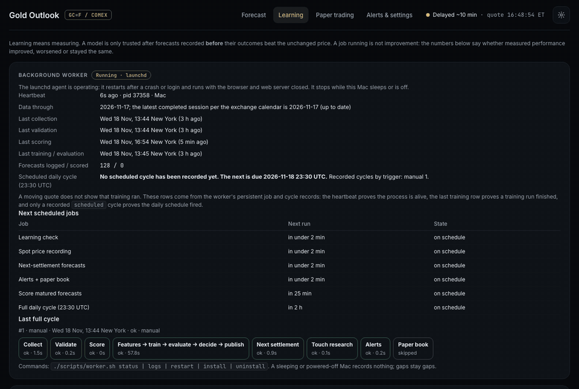
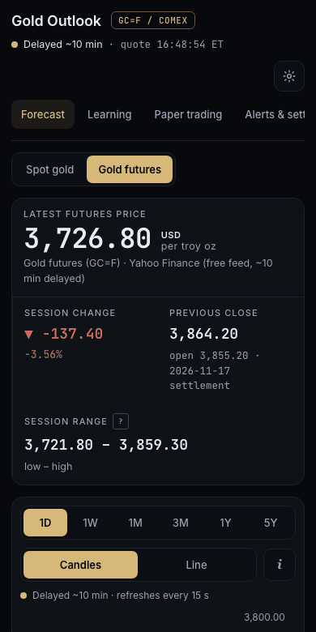
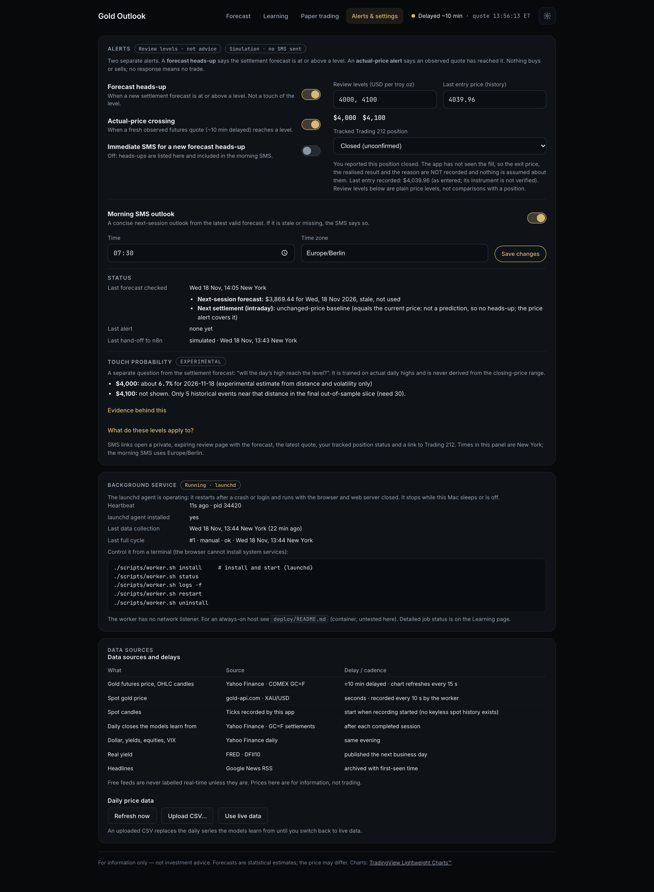

<h1 align="center">GOLD OUTLOOK</h1>
<h3 align="center">One metal. Four horizons. Show your work.</h3>

<p align="center">
  
  
  
  
  
</p>

<p align="center">
  <a href="#run-it"></a>
  <a href="docs/GUIDE.md"></a>
  <a href="docs/GUIDE.md#current-measured-results"></a>
</p>

<p align="center">
  <a href="#run-it"></a>
</p>
<p align="center"><b>Pick a horizon. Press Predict. See it on the chart.</b></p>

<br>

<table>
<tr>
<td width="66%" align="center"><a href="docs/GUIDE.md#how-learning-works"></a></td>
<td width="34%" align="center"><a href="docs/GUIDE.md#the-screen"></a></td>
</tr>
<tr>
<td align="center"><b>It shows its homework</b><br><sub>worker · active model per horizon · every candidate</sub></td>
<td align="center"><b>Works on your phone</b><br><sub>390 px, same workspace</sub></td>
</tr>
</table>

<table>
<tr>
<td width="50%" align="center"><a href="docs/GUIDE.md#paper-trading-simulation-only"></a></td>
<td width="50%" align="center"><a href="docs/GUIDE.md#alerts-sell-review-notifications"></a></td>
</tr>
<tr>
<td align="center"><b>Paper-trade it</b><br><sub>simulated · gold only · no broker</sub></td>
<td align="center"><b>Get alerted</b><br><sub>price levels via n8n + Twilio</sub></td>
</tr>
</table>

<br>

<a name="run-it"></a>
<h2 align="center">&#9654; Run it</h2>

```bash
./start.sh                       # installs, builds, opens the app
./scripts/worker.sh install      # optional: keeps learning with the browser closed (macOS)
```

<p align="center"><sub>Forecasts: next settlement · 1 · 5 · 20 sessions &nbsp;|&nbsp; COMEX gold futures (GC=F) &nbsp;|&nbsp; every forecast stored before its outcome exists</sub></p>

> [!NOTE]
> Honest by design: **no model beats "the price stays put" yet**, and the app says so on screen. [See the numbers →](docs/GUIDE.md#current-measured-results) &nbsp;·&nbsp; Not investment advice.

<p align="center"><a href="docs/GUIDE.md"><b>Full guide: how it learns, results, what is verified, operations →</b></a></p>
