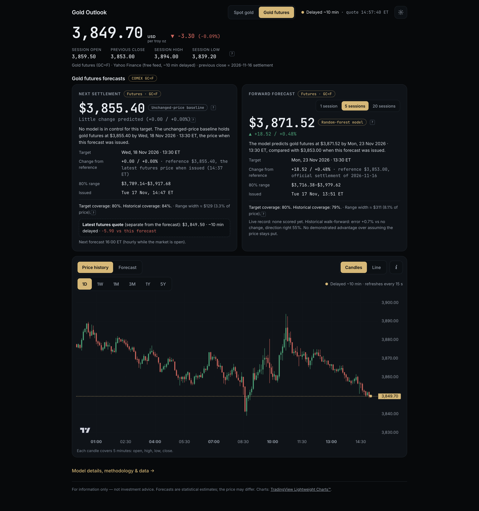
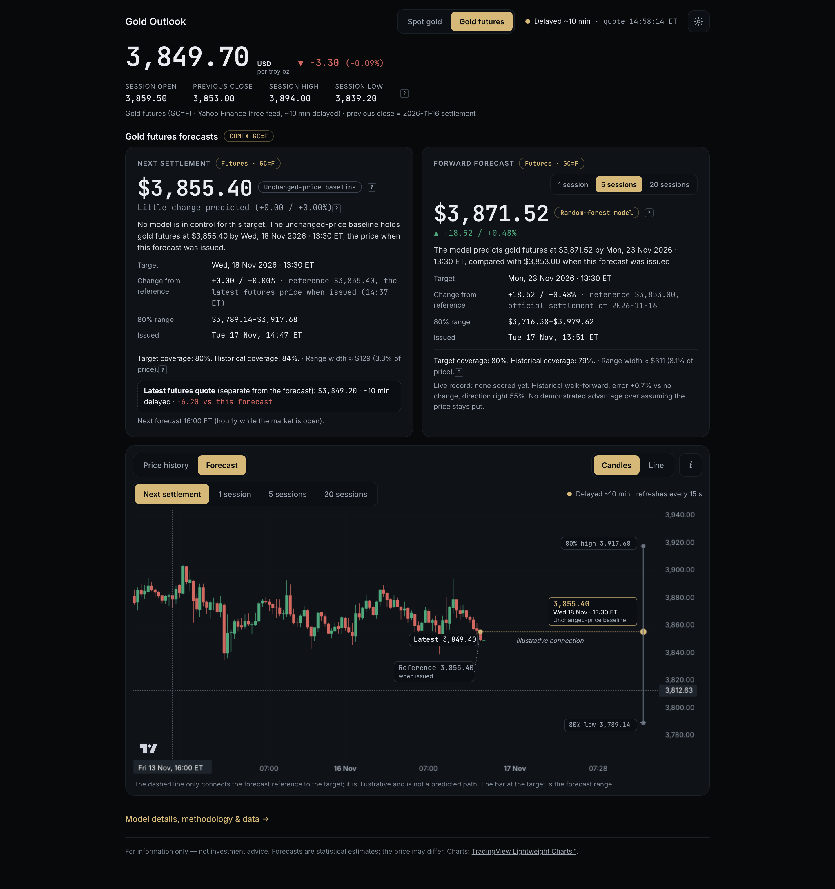
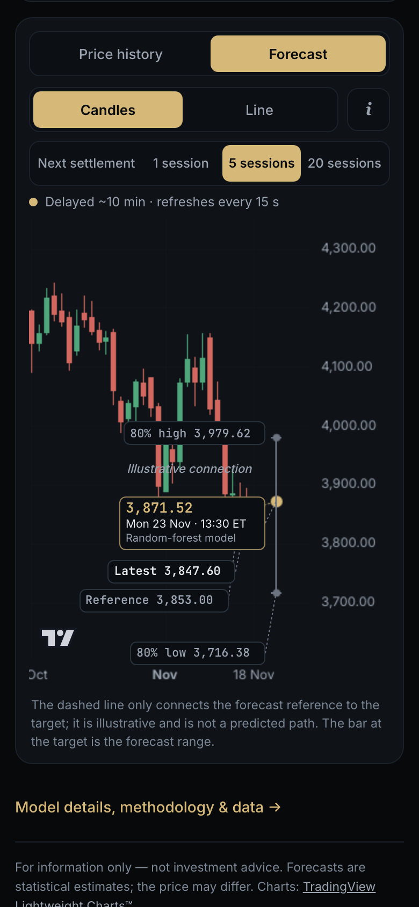

# Gold Outlook

A clean gold price app: one chart, two forecasts, and a learning loop that keeps score of its own predictions.



| Forecast view | Mobile |
|---|---|
|  |  |

**What it does not do:** predict gold to 99.99%, or at all reliably. Daily gold behaves close to a random walk, and the app measures and shows that instead of hiding it. Read [What the evidence says](#what-the-evidence-says).

## Start

```bash
./start.sh                 # installs on first run, builds the UI, serves http://localhost:8742
PORT=9000 ./start.sh       # another port
```

The web app starts an in-process background worker **only if no standalone worker is running**. For jobs that keep running with the browser, server and terminal closed, install the standalone worker (below).

### Background worker (macOS)

```bash
./scripts/launchd/install.sh      # per-user launchd agent; idempotent, starts at login, restarts on crash
./scripts/launchd/status.sh       # launchd state + what ran and when
./scripts/launchd/uninstall.sh    # stop and remove (data and logs are kept)
./scripts/launchd/install.sh --dry-run   # print the plist, change nothing
cd backend && PYTHONPATH=. .venv/bin/python -m app.worker once     # one full cycle now
cd backend && PYTHONPATH=. .venv/bin/python -m app.worker rollback fwd_5   # restore the previous champion
```

Logs: `~/Library/Logs/gold-outlook/worker.log`. **A sleeping or powered-off Mac records nothing.** On wake the worker re-downloads history (futures candles, daily closes, driver inputs) and runs any overdue cycle, but spot ticks and hourly intraday forecasts missed while asleep cannot be reconstructed; they stay as visible gaps.

## The screen

- **Header:** instrument (Spot gold / Gold futures), connection state with the latest quote time, settings.
- **Price summary:** latest price, session change, open, previous close, high, low, USD per troy oz. Each instrument has its own session convention (below); the two are never mixed.
- **Gold futures forecasts** (above the chart, two compact cards). Both show the forecast *as it was issued*: predicted price, target weekday/date/time/ET, change from the forecast reference, range, issue time and a plain sentence. The reference is frozen at issue and never follows the quote; the latest quote is shown separately and labelled. A prediction equal to the issue-time price is labelled **Unchanged-price baseline**, never presented as a learned prediction. A change smaller than 0.10% × √sessions reads "Little change predicted" (a display rule, not a confidence level). A forecast whose target has passed is shown as *Completed* with its actual and error.
- **Chart**, switchable between **Price history** and **Forecast** ([TradingView Lightweight Charts™](https://www.tradingview.com/), Apache-2.0, attribution shown). *Price history* is observations only: real OHLC candles or a 2px line with light shading, the candle/point interval stated, hover readout, one latest-price marker, ranges 1D–5Y; zoom survives live updates. *Forecast* (futures only) has an explicit Next settlement / 1 / 5 / 20 selector, recent history, a labelled reference, a dashed **Illustrative connection** (not a predicted path) and the target with its range at its real date; labels are collision-resolved and never clip. Provider and session detail sits behind the ⓘ button.
- **Model details** (drawer): current models and training times, scored forecasts, forward performance against "no change", the range-calibration audit, the last promotion decision and why, history and rollback, market drivers, backtest, news archive, methodology, data sources.

### Forecast timing, and the one genuine provider delay

A forward forecast must target a *future* session from a *finished* session's official settlement, and a forecast is never logged at or after its own target time. The official daily close is the 13:30 ET COMEX settlement (measured: the finalised GC=F daily close is within $1.50 of the 5-minute close at 13:25 ET over 48 sessions). Yahoo's free daily series **does not post that settlement when it is set**: its bar for the current session tracks the live price until the session is finalised. So a daily bar is treated as a completed observation only when the session has ended (17:00 ET) **and** its close agrees with the settlement-time price within $2; otherwise it is excluded and the cards say so. Until the next forecast can be issued, the last valid one stays visible with its issue time and target, marked *Completed* once its target passes. (Earlier, Yahoo's calendar-day "trading period" kept a finished session "unfinished" until midnight; that was wrong and is fixed.)

## Data sources and their real delays

| Data | Source | Delay / cadence |
|---|---|---|
| Futures price and **real OHLC** candles (all ranges) | Yahoo Finance, COMEX `GC=F` | ≈10 min delayed (free feed); chart refreshes every 15 s |
| Spot gold price | gold-api.com, XAU/USD | seconds; recorded every 10 s by the worker |
| Spot previous close | prices recorded at the 17:00 ET roll | **Unavailable from provider** until recorded: gold-api.com's history endpoint requires an API key, so there is no free backfill; no futures value is substituted |
| Spot candles | ticks recorded by this app | begin when recording began. No keyless provider offers spot OHLC history |
| Daily closes the models learn from | Yahoo Finance `GC=F` settlements | after each completed session |
| Dollar index, 10-yr yield, S&P 500, VIX | Yahoo Finance daily | same evening |
| 10-yr real yield | FRED `DFII10` | published the next business day |
| Headlines | Google News RSS | archived with first-seen time |

Delayed data is never labelled real-time. Streaming APIs are not used because none of the free feeds offers one; the update cadence is stated on screen instead.

**Session conventions.** *Futures:* 18:00 ET (previous evening) to 17:00 ET; change is measured against the previous official 13:30 ET settlement. *Spot:* FX day, 17:00 ET to 17:00 ET (DST-correct); open, high, low and previous close come from recorded prices (previous close only if a price was recorded within 10 minutes of the roll), and are marked when recording started late.

## How learning works

```
collect → validate & save → features → issue forecasts → wait for outcomes → score matured forecasts
        → train/evaluate challengers → retain or promote → repeat
```

- **Ledger** (`backend/data/gold.db`, SQLite): every forecast stores its id, instrument and exact target definition, model version, feature schema, issue time, input cutoff, base price, target time, prediction and range. The database itself **rejects edits and deletes** of forecasts, and outcomes are write-once. A retrained model issues new forecasts; it never rewrites old ones.
- **Only matured labels train anything.** A 20-session forecast is not a training example until its target session exists. Live price ticks never train anything.
- **Champion + challengers + shadows.** One versioned champion per forecast. Challengers (Ridge, gradient boosting, random forest × gold-only or gold-plus-drivers features) issue *shadow* forecasts into the same ledger so they are judged on outcomes that did not exist when they were made.
- **Promotion rule** (also shown in the app). A challenger needs *both*: (1) a walk-forward development result at least 2% better than the unchanged price **and** the incumbent, in ≥2 of 3 periods, with a Holm-corrected block-bootstrap p < 0.10 and a range that really covers ≈80%; and (2) ≥30 effective forward blocks (matured sessions ÷ horizon, because adjacent multi-session forecasts overlap) beating the unchanged price by ≥1% with a 90% interval below zero. At most one promotion per task per 30 days. Insufficient evidence retains the incumbent.
- **Rollback:** automatic if a promoted champion trails "no change" by ≥5% over ≥20 forward blocks; manual with `app.worker rollback`.
- **No reusable "untouched test".** Walk-forward numbers are development evidence and are labelled so. Only the forward record is out-of-sample proof.
- **Failure handling:** each job has its own lock (retraining cannot overlap itself), a failing job is logged and skipped, and the last valid data and champion stay in place.
- **Genuinely automated:** spot tick recording (10 s), hourly intraday forecasts, scoring (every 30 min), learning on fresh completed-session data, a full cycle daily at 23:30 UTC, and catch-up after downtime. Synthetic tests verify this *machinery*; they are not evidence about gold.

## What the evidence says

- **Today's settlement.** The estimate is the latest futures price; no model has beaten "price stays put" intraday. The range is the useful part: it held the real settlement **84% of the time across 121 distinct sessions (90% interval 80–87%)**, and it narrows from a typical miss of ≈$51 with 12+ hours left to ≈$3 in the last hour. The audit counts sessions, not the ~2,300 hourly rows in them, which are not independent.
- **Forward forecasts (1/5/20 sessions).** Walk-forward errors are within about ±5% of "price unchanged" (usually worse, not better) and direction is 48–59%. No model beats the unchanged price with statistical confidence at any horizon.
- **Do market drivers help?** (dollar, yields, real yields, S&P 500, VIX; joined by *availability time*, never by date; 589–598 identical forecast dates per horizon.) Drivers gave a statistically reliable improvement over gold-only for gradient boosting and random forest at 1 session and random forest at 20 — mostly by making over-fitting tree models lose *less* — but **nothing beat the unchanged price**, and with nine paired tests a few "significant" cells are expected by chance. A deliberately leaky same-day join scored about the same, so look-ahead is not what held the earlier experiments back. Not tested: economic-release surprises (no timestamped consensus data without a paid licence) and futures volume (continuous-contract volume is unreliable). Full tables: Model details → Market drivers.
- **News** is archived with original and first-seen timestamps and de-duplicated, but is **not a model input**: reliable historical news is unavailable, and an LLM's memory of past headlines is not a point-in-time record. It needs months of forward data before it can be evaluated. LLM event extraction is intentionally not enabled.
- **Range calibration, by horizon** (chronological walk-forward; each range uses only earlier information; ranges are not tuned after the fact). Historical coverage vs the claimed 80%: **1 session 80%** (90% interval 77–83), **5 sessions 79%** (74–83), **20 sessions 70%** (62–79; by period 71 / 78 / **62**), average widths 3.5% / 8.1% / 14.4% of price. The 20-session range is shown as **Under-calibrated** (more than 8 points below target) and is weakest in the most recent period.

## Development

```bash
cd backend && .venv/bin/python -m pytest -q          # 118 tests
cd frontend && npx tsc --noEmit && npm run build && node --test src/labels.test.mjs   # type check, build, label-collision tests
cd e2e && URL=http://127.0.0.1:8742 OUT=./shots node verify.mjs   # 72 browser checks, desktop + 390px
```

Layout: `backend/app/` — `market.py` (OHLC and summaries), `nowcast.py` (today's settlement), `learning.py` + `registry.py` + `ledger.py` + `db.py` (the loop), `drivers.py` + `research_drivers.py` (inputs and the controlled comparison), `worker.py` (daemon and CLI), `news_store.py`; `frontend/src/` — the single-screen UI; `scripts/launchd/` — background-worker install, uninstall, status.

Optional settings live in `.env` (see `.env.example`); `GOLD_EMBEDDED_WORKER=0` stops the web app from starting its own worker, and `GOLD_OFFLINE=1` disables all external calls. For information only; not investment advice.
