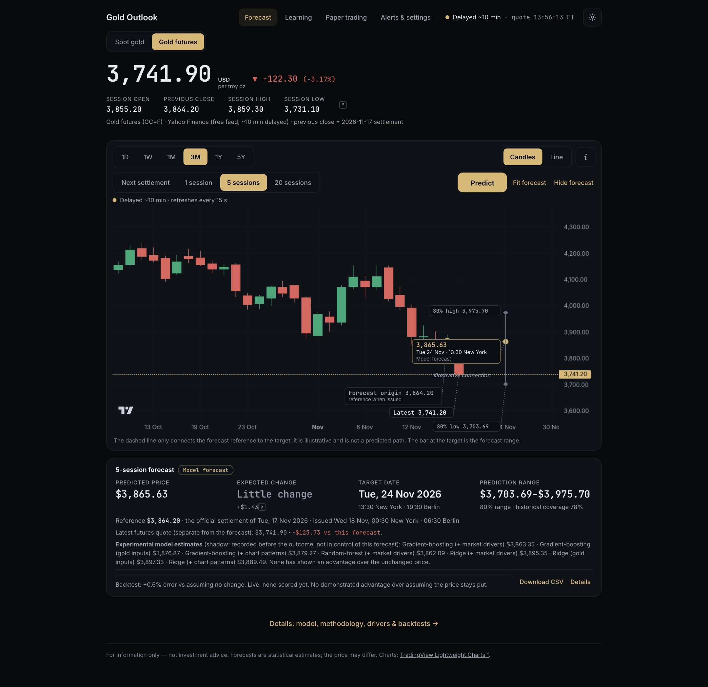
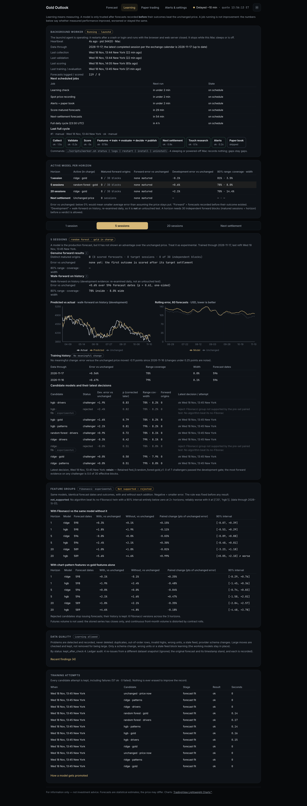
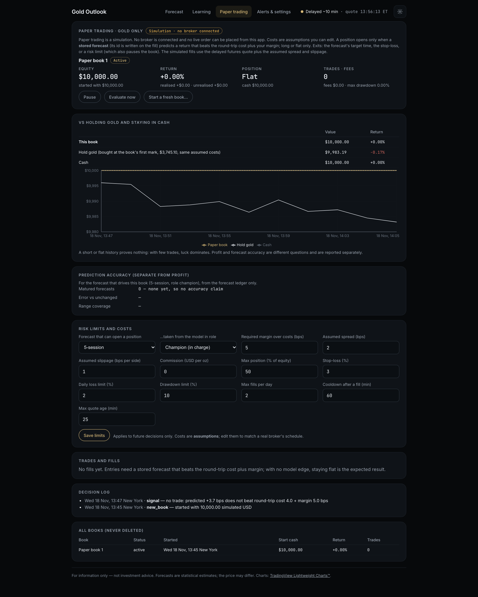
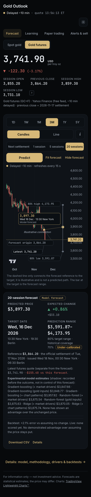

# Gold Outlook

A gold price app with one main screen — choose a horizon, press **Predict**, read the forecast on the chart — and, one click away, a **Learning** page that shows whether the models are really improving, a gold-only **Paper trading** simulation, and **Alerts & settings**.



| Learning | Paper trading | Mobile |
|---|---|---|
|  |  |  |

**What it does not do:** predict gold to 99.99%, or at all reliably. Daily gold behaves close to a random walk, and the app measures and shows that instead of hiding it. Read [What the evidence says](#what-the-evidence-says).

## Start

```bash
./start.sh                 # installs on first run, builds the UI, serves http://localhost:8742
PORT=9000 ./start.sh       # another port
```

The web app starts an in-process background worker **only if no standalone worker is running**. For jobs that keep running with the browser, server and terminal closed, install the standalone worker (below).

### Background worker (macOS)

```bash
./scripts/worker.sh install     # per-user launchd agent; idempotent, starts at login, restarts after a crash
./scripts/worker.sh status      # launchd state, which RUNTIME is operating, what ran last, next jobs
./scripts/worker.sh logs -f     # follow its logs
./scripts/worker.sh restart
./scripts/worker.sh uninstall   # stop and remove (data and logs are kept)
./scripts/worker.sh once        # one full cycle now, in this terminal
cd backend && PYTHONPATH=. .venv/bin/python -m app.worker rollback fwd_5   # restore the previous champion
```

The worker is its own process: it keeps running with the browser, the web server and the terminal closed (verified: it kept running jobs for 150 s with the web server stopped, and a `kill -9` was followed by an automatic restart). When the launchd agent is installed the web app does **not** start a second, embedded worker. The worker listens on **no port**. Its heartbeat records which runtime is operating (`launchd`, `container`, `web-embedded`, `manual`) and the Learning page and `status` report it. **A sleeping or powered-off Mac records nothing**; on wake the worker re-downloads history and runs any overdue cycle, but spot ticks and hourly intraday forecasts missed while asleep cannot be reconstructed and stay as visible gaps. For an always-on host see [deploy/README.md](deploy/README.md) (container files, **not built or run here**).

Logs: `~/Library/Logs/gold-outlook/worker.log`.

**Daily sequence** (every step recorded in `cycle_runs`; one failing step never stops the rest): collect → **validate** (quarantine bad data) → score matured forecasts → features → train candidates → evaluate → record the decision → publish forecasts → next settlement → touch research → deliver alerts → paper book. Persistent per-job state with bounded back-off (30 s, 2 min, 10 min, then hourly) and a retry limit; a scheduled or manual cycle starts every job fresh; collection is re-tried (at most every 15 min) while a completed session's data, per the exchange calendar, has not arrived.

## The screen

Four pages (hash routes: `#/forecast`, `#/learning`, `#/paper`, `#/alerts`) and a **Details** drawer (model, market drivers, backtest, news, methodology, GLD) behind the gear.

**Forecast** (the landing page)

- **Price summary:** latest price, session change, open, previous close, high, low, USD per troy oz, quote time and delay. Each instrument has its own session convention (below); the two are never mixed.
- **Choose → Predict → read it on the chart.** One chart with Line / Candles and history ranges 1D–5Y. Under it, a selector (**Next settlement / 1 / 5 / 20 sessions**) and one **Predict** button. Predict fetches the stored forecast for that choice and draws it on the *same* chart: a marker at the forecast origin, a dashed **Illustrative connection** (not a predicted path), a gold dot at the target with its price and New York date/time, and the prediction range. Below the chart, one compact strip: predicted price, expected change, target date (New York and Berlin) and range, with the reference price spelled out, the issue time and one performance note. **Hide forecast** restores the historical chart; **Fit forecast** refits the view; zoom survives live updates and Line/Candles switches. Changing the horizon clears the result until Predict is pressed again, and a newer forecast is offered, never swapped in. **Download CSV** is the displayed forecast (built from the same stored record). A prediction equal to the issue-time price is labelled **Unchanged-price baseline**; the experimental model estimates for the same target are listed beside it, labelled as shadow records. An under-calibrated range reads "80% target range · historical coverage 70%".
- **Chart** ([TradingView Lightweight Charts™](https://www.tradingview.com/), Apache-2.0, attribution shown): real OHLC candles or a 2px line with light shading, the candle/point interval stated, hover readout, one latest-price marker. Labels on a forecast are collision-resolved and never clip. Provider and session detail sits behind the ⓘ button. Alerts, the model, drivers, backtests and methodology live on their own pages and in the Details drawer, not on the main screen.

**Learning** — the worker/runtime and its next jobs; the active model **separately for each horizon**; candidates and their latest decisions; the number of **distinct matured forecast origins** per horizon; predicted vs actual and rolling error vs the unchanged price; range **coverage and width**; training history (*improved / worsened / no meaningful change*, with a noise tolerance); data quality; every training attempt including failures. **Genuine forward results** (recorded before the outcome existed) and **walk-forward history** (development evidence, re-examined daily) are separate blocks.

**Paper trading** — see below. **Alerts & settings** — the alerts panel, the tracked Trading 212 position, the background service (runtime, commands) and data sources.

### Forecast timing, and the one genuine provider delay

A forward forecast must target a *future* session from a *finished* session's official settlement, and a forecast is never logged at or after its own target time. The official daily close is the 13:30 ET COMEX settlement (measured: the finalised GC=F daily close is within $1.50 of the 5-minute close at 13:25 ET over 48 sessions). Yahoo's free daily series **does not post that settlement when it is set**: its bar for the current session tracks the live price until the session is finalised. So a daily bar is treated as a completed observation only when the session has ended (17:00 ET) **and** its close agrees with the settlement-time price within $2; otherwise it is excluded and the cards say so. Until the next forecast can be issued, the last valid one stays visible with its issue time and target, marked *Completed* once its target passes. (Earlier, Yahoo's calendar-day "trading period" kept a finished session "unfinished" until midnight; that was wrong and is fixed.)

## Data sources and their real delays

| Data | Source | Delay / cadence |
|---|---|---|
| Futures price and **real OHLC** candles (all ranges) | Yahoo Finance, COMEX `GC=F` | ≈10 min delayed (free feed); chart refreshes every 15 s |
| Spot gold price | gold-api.com, XAU/USD | seconds; recorded every 10 s by the worker |
| Spot previous close | prices recorded at the 17:00 ET roll | **Unavailable from provider** until recorded: gold-api.com's history endpoint requires an API key, so there is no free backfill; no futures value is substituted |
| Spot candles | ticks recorded by this app | begin when recording began. No keyless provider offers spot OHLC history |
| Daily closes the models learn from | Yahoo Finance `GC=F` settlements | after each completed session |
| Dollar index, 10-yr yield, S&P 500, VIX | Yahoo Finance daily | same evening |
| 10-yr real yield | FRED `DFII10` | published the next business day |
| Headlines | Google News RSS | archived with first-seen time |

Delayed data is never labelled real-time. Streaming APIs are not used because none of the free feeds offers one; the update cadence is stated on screen instead.

**Session conventions.** *Futures:* 18:00 ET (previous evening) to 17:00 ET; change is measured against the previous official 13:30 ET settlement. *Spot:* FX day, 17:00 ET to 17:00 ET (DST-correct); open, high, low and previous close come from recorded prices (previous close only if a price was recorded within 10 minutes of the roll), and are marked when recording started late.

## How learning works

```
collect → validate → score matured forecasts → features → train candidates → evaluate → record decision → publish forecasts → alerts → paper
```

- **Ledger** (`backend/data/gold.db`, SQLite): every forecast stores its id, instrument and exact target definition, model version, feature schema, issue time, input cutoff, base price, **dataset hash (the exact inputs)**, target time, prediction and range. The database itself **rejects edits and deletes** of forecasts, and outcomes are write-once. A retrained model issues new forecasts; it never rewrites old ones. A re-issue of an existing forecast id from a *different* dataset snapshot is ignored (the original and its timestamp stand) **and recorded** in `ledger_audit`, never silently reused.
- **Only matured labels train anything.** A 20-session forecast is not a training example until its target session exists, and many forecasts for the same target are not many independent outcomes. Live price ticks never train anything.
- **Champion + challengers + shadows.** One versioned champion per forecast. Challengers issue *shadow* forecasts into the same ledger so they are judged on outcomes that did not exist when they were made. Candidate set (bounded): ridge, gradient boosting and random forest × gold / gold+drivers features, plus ridge and gradient boosting on **chart-pattern** features and on the **experimental Fibonacci** group.
- **Feature groups.** `patterns_v1`: moving-average distances and slopes, trailing high/low distances and breakout strength, volatility-normalised. `fib_v1` (**experimental**): the retracement levels 23.6/38.2/50/61.8/78.6% of the trailing 20- and 60-session range, fixed in advance. Every feature uses data up to and including its own date only (trailing windows, no pivots needing later bars); tests recompute each feature on a truncated series and require identical values, so nothing can repaint. Futures volume is **not** used (the stored series has closes only, and continuous front-month volume is distorted by rolls). Fibonacci levels are inputs a model may use, never treated as support or resistance.
- **Keeping Fibonacci is an evidence decision made by a pre-set rule:** for the same algorithm on identical forecast dates and outcomes, adding Fibonacci must cut the error with a paired 90% block-bootstrap interval entirely below zero at ≥2 of 3 horizons and never reliably worsen it. Otherwise its candidates are **rejected** (they stop issuing forecasts; their history is kept).
- **Promotion rule** (also shown in the app). A challenger needs *both*: (1) a walk-forward development result at least 2% better than the unchanged price **and** the incumbent, in ≥2 of 3 periods, with a Holm-corrected block-bootstrap p < 0.10 and a range that really covers ≈80%; and (2) ≥30 effective forward blocks (matured sessions ÷ horizon) beating the unchanged price by ≥1% with a 90% interval below zero. At most one promotion per task per 30 days. Anything less retains the incumbent. Promotion criteria are never changed automatically.
- **Rollback:** automatic if a promoted champion trails "no change" by ≥5% over ≥20 forward blocks; manual with `app.worker rollback`.
- **No reusable "untouched test".** Walk-forward numbers are development evidence and are labelled so. Only the forward record is out-of-sample proof. Every candidate attempt, **including failures**, is logged. A failed evaluation or retrain keeps the working champion, and forecasts for a new session are still published.
- **"Self-cleaning" means detect, record, quarantine — never delete.** Duplicate/out-of-order rows, invalid highs, wrong units, a stale feed (by the exchange calendar) and provider schema changes are written to `data_quarantine` with the raw observation verbatim. Large moves are *checked* (does the day's high agree? did the next session reverse it?) and kept, not removed for being large. Only a schema change, wrong units or a stale feed block learning. Poor predictions, losing trades and failed experiments are never erased, and source code or promotion criteria are never rewritten automatically.
- **Genuinely automated, with evidence rather than claims:** a job running is not improvement. The Learning page compares successive evaluations and says whether measured performance improved, worsened or stayed the same.

## Paper trading (simulation only)

Gold only. A *book* is a simulated account (cash, at most one long position, fills, equity snapshots, frozen risk and cost parameters). Entries follow a rule, not a model's mood: a **stored, immutable forecast** (default: the 5-session champion; its id is written on the fill) must predict a return that beats the round-trip cost plus a margin; long or flat only. Exits: the forecast's target time, a stop-loss, or a risk limit (daily loss, drawdown), which also **pauses** the book. Configurable deterministic limits: position size, stop-loss, daily loss, drawdown, fills per day, cooldown, quote age. Fills use the delayed futures quote plus an **assumed** spread and slippage (editable; not a fact about any broker). Each decision is posted at most once. **Start a fresh book** archives the old one; nothing is deleted. The page compares the book with **holding gold** and **cash**, and reports **forecast accuracy separately from profit**. There is **no broker integration and no live order endpoint**; a test fails if the paper module ever imports a network or broker library. Architecture ideas (a risk gate that can only reduce activity, an append-only fill ledger, persisted pause and loss windows) come from [Martysunshine/ai-stock-trader](https://github.com/Martysunshine/ai-stock-trader) (MIT, © 2026 Martin Matysek); no code was copied.

## State-changing API calls are local-only

`GET`s are open on the loopback address the app binds to. `POST`/`PUT`/`DELETE` are accepted only from this machine and, if a browser sends an `Origin`, only from this app's own origin (so another website open in the same browser cannot drive it). Set `GOLD_API_TOKEN` to require an `X-Gold-Token` header instead (for scripts, behind HTTPS). The worker exposes no API at all.

## What the evidence says

- **Today's settlement.** The estimate is the latest futures price; no model has beaten "price stays put" intraday. The range is the useful part: it held the real settlement **84% of the time across 121 distinct sessions (90% interval 80–87%)**, and it narrows from a typical miss of ≈$51 with 12+ hours left to ≈$3 in the last hour. The audit counts sessions, not the ~2,300 hourly rows in them, which are not independent.
- **Forward forecasts (1/5/20 sessions).** Walk-forward errors are within about ±5% of "price unchanged" (usually worse, not better) and direction is 48–59%. No model beats the unchanged price with statistical confidence at any horizon.
- **Do market drivers help?** (dollar, yields, real yields, S&P 500, VIX; joined by *availability time*, never by date; 589–598 identical forecast dates per horizon.) Drivers gave a statistically reliable improvement over gold-only for gradient boosting and random forest at 1 session and random forest at 20 — mostly by making over-fitting tree models lose *less* — but **nothing beat the unchanged price**, and with nine paired tests a few "significant" cells are expected by chance. A deliberately leaky same-day join scored about the same, so look-ahead is not what held the earlier experiments back. Not tested: economic-release surprises (no timestamped consensus data without a paid licence) and futures volume (continuous-contract volume is unreliable). Full tables: Model details → Market drivers.
- **Chart patterns and Fibonacci** (first real run, data through 2026-11-17; 589–598 identical forecast dates per horizon; ridge and gradient boosting). Adding the moving-average / breakout group to the gold features changed the error by −0.5 to +0.5 points of the unchanged-price error with every 90% interval spanning zero. **Fibonacci was not supported** by the pre-set rule: no algorithm beat its no-Fibonacci twin at two or more horizons, and gradient boosting was reliably *worse* with it at 20 sessions (+0.99 points, interval +0.05 to +2.10), so its six candidates were rejected. **Still no model beats the unchanged price** at any horizon (development errors +0.0% to +5.6% against it).
- **News** is archived with original and first-seen timestamps and de-duplicated, but is **not a model input**: reliable historical news is unavailable, and an LLM's memory of past headlines is not a point-in-time record. It needs months of forward data before it can be evaluated. LLM event extraction is intentionally not enabled.
- **Range calibration, by horizon** (chronological walk-forward; each range uses only earlier information; ranges are not tuned after the fact). Historical coverage vs the claimed 80%: **1 session 80%** (90% interval 77–83), **5 sessions 79%** (74–83), **20 sessions 70%** (62–79; by period 71 / 78 / **62**), average widths 3.5% / 8.1% / 14.4% of price. The 20-session range is shown as **Under-calibrated** (more than 8 points below target) and is weakest in the most recent period.

## Alerts (sell-review notifications)

User-selected **review levels** (default $4,000 and $4,100, USD per troy ounce), never trading advice. The tracked Trading 212 position is recorded as **closed (unconfirmed)**: the app has not seen the fill, so the exit price, the realised result and the reason are *not recorded* and nothing is assumed (the old entry, $4,039.96, is kept as history; you can enter exit details yourself, or mark the position open again, which restores the entry comparison). While closed, alerts are plain price-level notices. Nothing buys or sells; no response means no trade. Two separate alerts:

- **Forecast heads-up:** the next-session *settlement* forecast is at or above a level. It forecasts the close, not whether the day's high touches the level, and says so. A forecast that merely equals the current price (the unchanged-price baseline) never raises it.
- **Actual-price crossing:** a *fresh observed* quote crossed to or above a level (futures by default, ~10 min delayed; spot optional). Stale quotes raise nothing.

Reliability: one alert per (instrument, threshold, target session, alert type, episode), enforced by a unique key in SQLite; re-arm only after the price was seen below the level (next session by default, or after a configurable drop); alerts expire instead of being texted late; every check, decision and delivery is written to `alert_log` / `alert_events` / `alert_deliveries`. SMS *accepted by the provider* is tracked separately from *delivered*. Alerts read the forecast ledger and never feed training.

**Delivery is n8n + Twilio** (morning outlook default 07:30 Europe/Berlin, configurable in the Alerts panel; optional immediate SMS for a new heads-up). Because a hosted schedule cannot reach a sleeping Mac, the app *pushes* each forecast snapshot to n8n, which runs the morning job from its stored copy and says so when that copy has expired. Setup, the deployment requirement and what remains impossible while the Mac is off: [n8n/README.md](n8n/README.md). The default mode is simulation: **no SMS is sent and n8n is not contacted** until `GOLD_ALERTS_MODE=live` and the `N8N_*` values are set.

```bash
cd backend && PYTHONPATH=. .venv/bin/python -m app.worker alerts --simulate --price 4101 --forecast 4120   # throwaway database, no SMS
cd backend && PYTHONPATH=. .venv/bin/python -m app.worker threshold --force                                 # re-run the threshold research
```

**Touch probability ("will the high reach $4,100?") is a separate, experimental target**, trained on actual daily highs (the provider's daily-bar high was checked against 5-minute data: it is the CME session 18:00-17:00 New York, exact on 21 of 21 days), never derived from the settlement range. Chronological, purged walk-forward; the final slice is never used to choose anything; a probability is shown only if the distance-matched history has at least 30 distinct event dates and is calibrated. Today it is **not shown**. Details, precision/recall, false alerts, missed events, calibration and lead time are in the Alerts panel.

## Development

```bash
cd backend && .venv/bin/python -m pytest -q          # 255 tests
cd frontend && npx tsc --noEmit && npm run build && node --test src/labels.test.mjs src/ranges.test.mjs   # type check, build, unit tests
cd e2e && URL=http://127.0.0.1:8750 OUT=./shots node verify.mjs   # 76 browser checks: Predict flow, all horizons, states, export, desktop + 390px
bash e2e/run_alerts.sh                                            # 54 alert checks (throwaway data, simulated prices, no SMS)
bash e2e/run_pages.sh                                             # 53 Learning / Paper / Alerts-page checks (throwaway data)
```

Layout: `backend/app/` — `market.py` (OHLC and summaries), `nowcast.py`, `learning.py` + `registry.py` + `ledger.py` + `db.py` (the loop), `feature_groups.py` (patterns, Fibonacci), `quality.py` (quarantine), `paper.py` (simulation), `workspace.py` (Learning payload), `drivers.py` + `research_drivers.py`, `alerts.py` + `n8n_link.py` + `review.py` + `threshold_research.py`, `worker.py` (daemon and CLI); `frontend/src/` — the four pages; `scripts/worker.sh` + `scripts/launchd/`; `deploy/` — always-on worker files (untested here); `n8n/` — the alert workflow.

Optional settings live in `.env` (see `.env.example`); `GOLD_EMBEDDED_WORKER=0` stops the web app from starting its own worker, `GOLD_OFFLINE=1` disables all external calls, `GOLD_API_TOKEN` protects state-changing calls. For information only; not investment advice.
